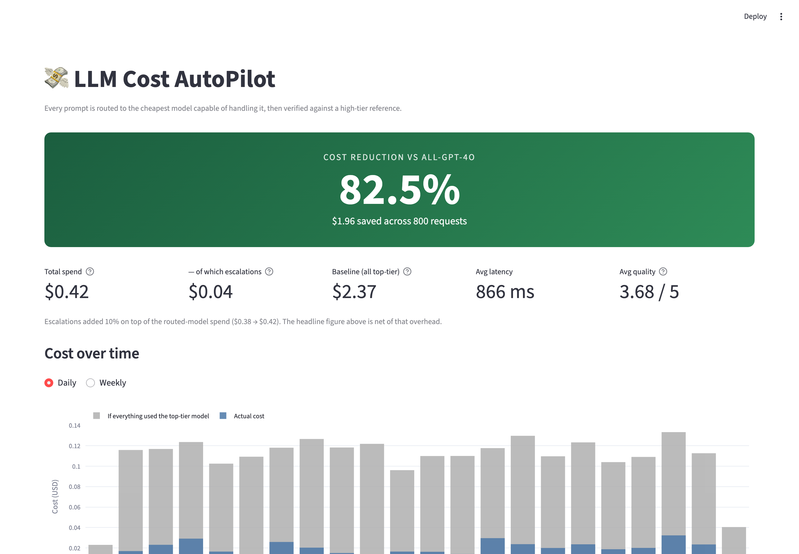

# 💸 LLM Cost AutoPilot

**An intelligent routing layer that cuts LLM spend ~82% without flying blind on quality.**

Most applications send every prompt to their best model. Most prompts don't need it.
AutoPilot classifies each prompt's complexity, routes it to the cheapest model capable
of handling it, then **verifies the result against a high-tier model** and automatically
escalates when quality falls short. Every failure becomes training data, so routing gets
better over time.

---

## The number

> ### 82.5% cost reduction
> **$0.42 spent vs $2.37** if every request had gone to the top-tier model —
> across an 800-request load test, with 85.6% of traffic served without ever
> touching a premium model, at **86.9% routing accuracy** on held-out prompts.



📄 **[Read the case study](CASE_STUDY.md)** · 📊 [Full load test report](reports/load_test_report.md)
· 🖼 [Full dashboard](reports/screenshots/dashboard-full.png)

That figure is **net of escalation spend**. When verification catches a bad answer,
AutoPilot re-runs it on a better model and that second call is counted against the
savings, not hidden from them. The naive number would be 84.1%; the honest one is 82.5%.

| | |
|---|---|
| Routed-model spend | $0.38 |
| Escalation spend (re-runs) | $0.04 |
| **Total** | **$0.42** |
| Baseline (all top-tier) | $2.37 |
| Requests | 800 |
| Routing accuracy (held-out) | 86.9% |
| Throughput / p95 latency | 30 req/s / 1,454 ms |

### What this number is, and what it isn't

It is **arithmetic on real published prices**, not a measured finding. Two caveats that
matter more than the figure itself:

- **It describes a traffic mix, not the router.** The same code produces 63.4%–91.7%
  depending only on what you send it:

  | Traffic mix | Savings |
  |---|---:|
  | Light (70/25/5) | 91.7% |
  | **Typical (50/35/15)** | **81.9%** |
  | Uniform (33/33/33) | 67.8% |
  | Heavy (25/35/40) | 63.4% |

  Quote it *with* the mix or it means nothing.
- **Token counts are simulated.** In mock mode they are counted with `tiktoken` against
  synthetic responses — accurate tokenization of text no real model produced. Real usage
  numbers require real API keys.

What *is* measured: **86.9% routing accuracy** on prompts held out from training, with
6.1% under-routed (sent to a model below the tier they needed) — the failure direction
that inflates savings while degrading answers, and the one the verifier exists to catch.

```bash
python scripts/significance_analysis.py   # classifies every metric in this repo
```

*Numbers from `scripts/seed_demo_data.py` in mock-provider mode. Run it yourself and the
dashboard will show your own.*

---

## Architecture

```
                    ┌─────────────────────────────────────────┐
   POST             │              ROUTING ENGINE             │
 /v1/completions ──▶│                                         │
                    │  1. Classify complexity  (RandomForest) │
                    │  2. Map tier → model     (routing.yaml) │
                    │  3. Call provider                       │
                    └────────────────┬────────────────────────┘
                                     │
              ┌──────────────────────┼──────────────────────┐
              ▼                      ▼                      ▼
        ┌──────────┐          ┌───────────┐          ┌───────────┐
        │  tier 1  │          │  tier 2   │          │  tier 3   │
        │ llama3.2 │          │gpt-4o-mini│          │  gpt-4o   │
        │  (free)  │          │  (cheap)  │          │(expensive)│
        └──────────┘          └───────────┘          └───────────┘
              └──────────────────────┼──────────────────────┘
                                     │
                       response returned to caller
                                     │
                                     ▼
                    ┌─────────────────────────────────────────┐
                    │      ASYNC VERIFICATION (off-path)      │
                    │                                         │
                    │  Send the SAME prompt to the top-tier   │
                    │  model and compare the two outputs:     │
                    │                                         │
                    │   extraction    → field coverage ≥4.5   │
                    │   classification→ label match    =5.0   │
                    │   summarization → judge rubric   ≥4.0   │
                    │   general       → agreement      ≥3.5   │
                    └────────────────┬────────────────────────┘
                                     │  failed?
                         ┌───────────┴───────────┐
                         ▼                       ▼
                  ┌─────────────┐         ┌──────────────┐
                  │  ESCALATE   │         │   FEEDBACK   │
                  │ re-run one  │         │ failure  →   │
                  │ tier up if  │         │ training row │
                  │ latency ok  │         │ → retrain    │
                  └──────┬──────┘         └──────┬───────┘
                         │                       │
                         ▼                       ▼
                    SQLite audit trail    classifier improves
                         │
                         ▼
                  Streamlit dashboard
```

**The flywheel:** every routing mistake the verifier catches becomes a labelled example
with a corrected tier. The classifier retrains on a weekly cadence, so the prompts it
used to misjudge are exactly the ones it learns from.

---

## Quick start

### Docker (everything at once)

```bash
docker compose up --build
```

| Service | URL | What it is |
|---|---|---|
| API | http://localhost:8000/docs | Interactive OpenAPI docs |
| Dashboard | http://localhost:8501 | Cost and quality charts |
| Worker | — | Periodic classifier retraining |

Runs in **mock-provider mode** by default, so it works with no API keys. For real calls,
copy `.env.example` to `.env`, add your keys, and set `MOCK_PROVIDERS=false`.

> **Going live requires an API key.** With `MOCK_PROVIDERS=false` the service refuses to
> start unless `AUTOPILOT_API_KEY` is set — one request can fan out to three paid model
> calls, so an open endpoint is a billing risk. A missing or placeholder provider key
> also raises rather than silently returning fabricated answers. See
> [SECURITY.md](SECURITY.md).

### Local

```bash
python -m venv .venv && source .venv/bin/activate
pip install -r requirements.txt
python scripts/train_classifier.py
uvicorn src.api.main:app --reload
```

Then, in another shell, generate some history and open the dashboard:

```bash
python scripts/seed_demo_data.py --days 21 --per-day 10
streamlit run dashboard/app.py
```

---

## API

### `POST /v1/completions`

A standard chat-completion request — with no `model` field. Choosing the model is the
service's job.

```bash
curl -s localhost:8000/v1/completions \
  -H 'content-type: application/json' \
  -H "X-API-Key: $AUTOPILOT_API_KEY" \
  -d '{"messages": [{"role": "user", "content": "What is a Python decorator?"}]}'
```

```jsonc
{
  "id": 42,
  "content": "A decorator is …",
  "latency_ms": 412.0,
  "routing": {
    "tier": "moderate",
    "selected_model": "gpt-4o-mini",
    "use_case": "explanation",
    "reasoning": "Classified as moderate (confidence: 71%). Routed to gpt-4o-mini per tier_2 config."
  },
  "cost": {
    "actual_cost": 0.000050,
    "hypothetical_cost": 0.001236,
    "savings_percentage": 95.95
  }
}
```

| Endpoint | Purpose |
|---|---|
| `POST /v1/completions` | Route a prompt; returns the answer plus which model and why |
| `GET /v1/completions/{id}/escalation` | Collect the improved answer, if verification produced one |
| `GET /v1/models` | Available models and their per-token costs |
| `GET /v1/stats` | Cost savings summary — the headline number |
| `GET /v1/routing-config` | Current tier → model mapping |
| `PUT /v1/routing-config` | Remap tiers to models **without redeploying** |
| `GET /health` | Liveness, and whether the classifier is trained |

Swap the model behind a tier at runtime — validated against the registry, so a typo
can't point the router at a model that doesn't exist:

```bash
curl -X PUT localhost:8000/v1/routing-config \
  -H 'content-type: application/json' \
  -d '{"routing": {"tier_2": {"primary": "claude-haiku-4-5"}}}'
```

---

## How quality is judged

"Good enough" is not one number. Each use case is graded on what actually matters for it,
against a reference response from the highest-tier model:

| Use case | Bar | How it's scored |
|---|---|---|
| Extraction | 4.5 | Did it capture every key field the reference found? |
| Classification | 5.0 | Does its label match the reference label exactly? |
| Summarization | 4.0 | LLM-as-judge rubric (accuracy / completeness / coherence) |
| Code generation | 3.8 | Same rubric, lower bar |
| Explanation | 3.5 | Same rubric |
| General | 3.5 | Semantic agreement with the reference |

All of it is tunable in [`config/routing.yaml`](config/routing.yaml) without touching code.

---

## Project layout

```
src/
  classifier/     complexity classification (features → RandomForest → tier)
  router/         routing engine + escalation manager
  models/         provider adapters (OpenAI, Anthropic, Ollama) + registry
  verifier/       use-case policies, reference judge, async worker, feedback loop
  logging/        SQLite schema, audit trail, aggregate queries
  api/            FastAPI surface
  service.py      composition root — wires routing to verification
dashboard/        Streamlit cost dashboard
scripts/          train, evaluate, rebuild data, seed, demo, worker
tests/            111 tests
```

---

## Development

```bash
pytest                                   # 111 tests
python scripts/evaluate_classifier.py    # honest classifier evaluation
python scripts/demo_phase3.py            # verification loop, end to end
python scripts/build_training_data.py --check   # validate corpus balance
```

### On the classifier's accuracy

`scripts/evaluate_classifier.py` reports **71.8% ± 6.6% cross-validated accuracy**
(5-fold × 10 repeats) on a 3-class problem where chance is 33%. A permutation test against
shuffled labels gives p = 0.005, so the signal is real — but the fold range is
[59.6%, 83.1%], so treat it as "clearly better than guessing", not as a precise figure.
It is also measured on a hand-authored corpus, which means it reflects agreement with
that corpus's author rather than performance on live traffic.

It is deliberately not higher.

An earlier version of this project reported **100%** — because the training corpus encoded
tier in prompt length. Tier 1 prompts capped at 63 characters, tier 3 started at 191, and
a single length threshold scored 93%. The classifier never had to read the prompt, and the
test split couldn't reveal it because it shared the same skew.

The corpus was rebuilt so length carries no tier signal, and three tests now guard it:
length-only baseline must stay near chance, tier length ranges must overlap, and
length-proxy features must stay under 50% of the model's decision weight. The evaluation
script reports all three alongside accuracy, so the failure mode can't come back quietly.

A permutation test confirms the fix: length alone now scores 37.7% against a shuffled-label
baseline of 33.6%, p = 0.118 — **statistically indistinguishable from chance**. That is the
most solid result in this repo, and it was a 93% leak before.

This is why verification matters: the classifier is imperfect, and the system is designed
to catch and correct its mistakes rather than pretend they don't happen.

---

## Known limitations

- **Verification runs in-process.** The queue is an in-memory `asyncio.Queue`, so it
  cannot be consumed from a separate container. The `worker` service handles retraining,
  which *is* separable. Scaling verification out would need a real broker (Redis, SQS).
- **SQLite.** Fine for a single host with WAL enabled; swap `DATABASE_URL` for Postgres
  before running this anywhere with real traffic.
- **Escalated answers are polled, not pushed.** Verification finishes after the response
  has already been returned, so `GET /v1/completions/{id}/escalation` is how a caller
  collects the better answer. A streaming transport would let it be pushed instead.
- **Mock mode is a simulation.** Default runs use synthetic responses whose quality
  degrades by tier. Real numbers require real API keys.

## License

MIT
